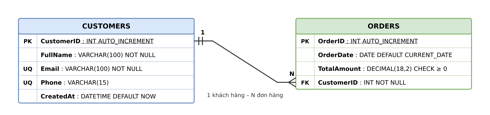

# Kiến trúc quan hệ Khách Hàng - Đơn Hàng

Thiết kế quan hệ **1 – N** giữa `CUSTOMERS` và `ORDERS` cho tính năng Đặt hàng: một khách hàng có thể tạo nhiều đơn hàng, và mỗi đơn hàng bắt buộc phải thuộc về một khách hàng có thật trong hệ thống.

## 1. Sơ đồ ERD

[](erd-customers-orders.png)

[Xem sơ đồ ERD trên draw.io](https://app.diagrams.net/?title=erd-customers-orders.drawio#R7Ztvc6I6FMY%2FDW93gKCjLynS287aupfq3ZdOKlEyjYkTYlv3098T%2Fqgobmuvt7oNM7ZDDkkIeZ7wEzlYKJi%2F%2FiXxIrkTMWGWa88kjS3Us1zXhj8ILPCMbAVQaKFACqHyrflrQJhuV211fWCvU%2FYpCVfvaaDGwehhOLgLo4e86TNmy2I8O3tStWLFnjTBC72p8KMOXaUKS%2FVAf%2BkY8iAwEVxhyomEgJOVGcOLlGbVe7aOJJTFfbwSS1V2VJaupvSVxJF4SYvWUrz0obOyOIXOH4rB6DJmdMZhewLnrI8I7RkLBBMyGy2KMelMJ9kwpXgiW3vakw55nJZd5uN39PiLuSBSkdeDM%2Bus9QKNiZgTJVdQpWjgFfquqsUXGqskD6FOEUsInSVlpx0vD%2BI0D8zWPW9khI1CyTdVHUt7T9jf6wkTDzOQCEl%2FaRVZIdi2xln5hc4Z5uSG4HgndCXiVRHaloILTmq9EEuxGGI5I6oILATlKjv%2F1hV84AwC%2B1vLasFYAyg7mzJ8dHWpAsFBXvCc7oPgVL2QVO1pTnlCJNVxJRbFwRiZlseVhQ56%2B1EoJeaFxd7lh521tO%2BMwgrIe58VkH1qJ4yf9rzw4%2FtBN8C5KYpZRCYK81m20AVMwZRpg%2FQSGseE52ud6yobPWtEP0qG9dTvarK78o%2BVpVgM%2B8psSeEdqUTR2WaWju4NM7hscaxg3Sx5nO7Jux7nRxR%2F3r%2BsL1OYXSJvoQCT6sP%2F2%2Fsh%2FPdHw8H49j6IwrtQBz7BFuWlOxf%2FRC5JF3hC%2BayfV23v%2BKZ1St%2B8Hr64n9ZH6MxGchqIXBZE2ueCiFMDEaMQ4piFEKcGIddLxu7xnKwB8o8fBTd%2BZLkdx4ahdSF0P9BMuR%2F1%2B1%2BJJCezizHkcBtyXBY5uucih1tDjtHfRrHDNYsdbg07wjmmrAHHh71iDDhQA47LAofjnoscqCEHMoscqIYcPxItSQ05Whk4TGYFMpwVXsOKC2NF61ys8Ez%2FfcozixRe3SMOSeBYsa%2FWtOj5w3B4exfqzfDaH%2FWze4zBT7Ox4ZmIjUHUq8t22A7%2FuakOLdKJvbpUh477iNrt%2FyfVof3RXIfWSXIdcuWaRIdP%2FBKwWSwXkuWw9oChKQ6VNfDF4b%2FRep%2F8Axk3mQ3%2F2S4mfAFochouixfts%2FDCzGyGygowhBbOIVr04FiV%2B8TKPWIwiiJgxjjfYdzN4htOMQMUTQrDJYGiexZQuEaDwjUIFHVJC0MBy9ifw4G2flIMg9s7v68fQHVgObl59kJwEwbfdZ3QtTpdy4dnU7ZtMDhck8HRpDBcEjg%2BOX9hbYIaclwb9JMUMogd6Jj3bYxOdHvDHV%2BZD1K%2FCLxjEpgj%2BymxAmT5ziTRw8m2bT4rv0vYVhdpu%2Bhy4FldxwraUJlX6%2B74iMQzUi5dmHyqVhFhWFHBw82eyiMhVwNIzVmx1gmPfSkzt4XRHPNViaNKNB5kDoPK15RVqFUpa8P9LKbeXVtFj%2FH3D57glMRSTsjhl1tVibD3eEtmU%2FBcPegR13oobl7QzvXfvOGNwn8B)

## 2. Phân tích (I/O)

### Dịch nghiệp vụ sang SQL

| Quy tắc nghiệp vụ | Cách thể hiện trong SQL |
|---|---|
| Một khách hàng có nhiều đơn hàng | `ORDERS.CustomerID` là **khóa ngoại** tham chiếu `CUSTOMERS.CustomerID` (quan hệ 1 – N) |
| Đơn hàng **bắt buộc** thuộc về một khách hàng | `CustomerID INT NOT NULL` kết hợp `FOREIGN KEY`: không được để trống và phải tồn tại trong `CUSTOMERS` |
| Không nhập ngày đặt thì lấy ngày hiện tại | `OrderDate DATE NOT NULL DEFAULT (CURRENT_DATE)` |
| Tổng tiền phải chính xác, không âm | `DECIMAL(18, 2)` kết hợp `CHECK (TotalAmount >= 0)` |
| Không được xóa khách hàng đang có đơn | `ON DELETE RESTRICT` |

### Bảng CUSTOMERS (bảng cha)

| Cột | Kiểu dữ liệu | Ràng buộc | Lý do |
|---|---|---|---|
| `CustomerID` | `INT` | `PRIMARY KEY`, `AUTO_INCREMENT` | Định danh duy nhất mỗi khách hàng, tự sinh mã |
| `FullName` | `VARCHAR(100)` | `NOT NULL` | Tên có độ dài thay đổi và bắt buộc phải có |
| `Email` | `VARCHAR(100)` | `NOT NULL`, `UNIQUE` | Dùng để liên hệ, mỗi email chỉ thuộc một khách hàng |
| `Phone` | `VARCHAR(15)` | `UNIQUE` | Lưu dạng chuỗi để giữ số 0 ở đầu và dấu `+` |
| `CreatedAt` | `DATETIME` | `NOT NULL`, `DEFAULT CURRENT_TIMESTAMP` | Tự ghi thời điểm tạo tài khoản |

### Bảng ORDERS (bảng con)

| Cột | Kiểu dữ liệu | Ràng buộc | Lý do |
|---|---|---|---|
| `OrderID` | `INT` | `PRIMARY KEY`, `AUTO_INCREMENT` | Mã đơn duy nhất, tự sinh |
| `OrderDate` | `DATE` | `NOT NULL`, `DEFAULT (CURRENT_DATE)` | Chỉ cần ngày. Tự lấy ngày hiện tại nếu không nhập |
| `TotalAmount` | `DECIMAL(18, 2)` | `NOT NULL`, `DEFAULT 0`, `CHECK (TotalAmount >= 0)` | Tiền tệ cần chính xác tuyệt đối và không âm |
| `CustomerID` | `INT` | `NOT NULL`, `FOREIGN KEY → CUSTOMERS(CustomerID)` | Liên kết đơn hàng với một khách hàng có thật. Cùng kiểu `INT` với khóa chính được tham chiếu |

## 3. Bẫy dữ liệu: thứ tự thực thi

Khóa ngoại của `ORDERS` trỏ tới `CUSTOMERS`. Nếu chạy `CREATE TABLE ORDERS` trước, MySQL báo lỗi *"Failed to open the referenced table 'CUSTOMERS'"* (mã lỗi 1824), vì bảng được tham chiếu chưa tồn tại.

Quy tắc sắp xếp câu lệnh:

1. **Tạo bảng:** bảng cha (`CUSTOMERS`) trước, bảng con (`ORDERS`) sau.
2. **Thêm dữ liệu:** thêm khách hàng trước, thêm đơn hàng sau. Đơn hàng có `CustomerID` không tồn tại sẽ bị từ chối.
3. **Xóa bảng:** làm **ngược lại**, xóa bảng con trước rồi mới xóa bảng cha. Nếu xóa `CUSTOMERS` trước, MySQL sẽ báo lỗi vì `ORDERS` vẫn đang tham chiếu tới nó.

## 4. Script SQL hoàn chỉnh

```sql
-- =====================================================
-- Kiến trúc quan hệ Khách Hàng - Đơn Hàng (1 - N)
-- MySQL 8.0.16+ (DEFAULT (CURRENT_DATE) cần 8.0.13+, CHECK cần 8.0.16+)
-- =====================================================

CREATE DATABASE IF NOT EXISTS shop_db;
USE shop_db;

-- Xóa bảng cũ (nếu có) theo thứ tự NGƯỢC: bảng con trước, bảng cha sau
DROP TABLE IF EXISTS ORDERS;
DROP TABLE IF EXISTS CUSTOMERS;

-- 1. Tạo bảng CHA trước: CUSTOMERS
CREATE TABLE CUSTOMERS (
    CustomerID INT AUTO_INCREMENT PRIMARY KEY,
    FullName   VARCHAR(100) NOT NULL,
    Email      VARCHAR(100) NOT NULL UNIQUE,
    Phone      VARCHAR(15)  UNIQUE,
    CreatedAt  DATETIME     NOT NULL DEFAULT CURRENT_TIMESTAMP
);

-- 2. Tạo bảng CON sau: ORDERS (tham chiếu CUSTOMERS)
CREATE TABLE ORDERS (
    OrderID     INT AUTO_INCREMENT PRIMARY KEY,
    OrderDate   DATE           NOT NULL DEFAULT (CURRENT_DATE),
    TotalAmount DECIMAL(18, 2) NOT NULL DEFAULT 0,
    CustomerID  INT            NOT NULL,
    CONSTRAINT chk_orders_total CHECK (TotalAmount >= 0),
    CONSTRAINT fk_orders_customers
        FOREIGN KEY (CustomerID) REFERENCES CUSTOMERS (CustomerID)
        ON DELETE RESTRICT
        ON UPDATE CASCADE
);

-- 3. Dữ liệu mẫu: thêm khách hàng trước, đơn hàng sau
INSERT INTO CUSTOMERS (FullName, Email, Phone) VALUES
    ('Nguyễn Văn An', 'an.nguyen@gmail.com', '0912345678'),
    ('Trần Thị Bình', 'binh.tran@gmail.com', '0987654321');

INSERT INTO ORDERS (OrderDate, TotalAmount, CustomerID) VALUES
    ('2026-11-10', 1250000.00, 1),
    ('2026-11-12',  499000.50, 1);

-- Không nhập OrderDate -> tự động lấy ngày hiện tại
INSERT INTO ORDERS (TotalAmount, CustomerID) VALUES (320000.00, 2);

SELECT * FROM ORDERS;

-- 4. Kiểm thử toàn vẹn dữ liệu: các lệnh dưới đây phải bị từ chối
-- INSERT INTO ORDERS (TotalAmount, CustomerID) VALUES (100000, 999);  -- lỗi khóa ngoại: khách hàng 999 không tồn tại
-- INSERT INTO ORDERS (TotalAmount, CustomerID) VALUES (100000, NULL); -- lỗi NOT NULL: đơn hàng phải có khách hàng
-- INSERT INTO ORDERS (TotalAmount, CustomerID) VALUES (-50000, 1);    -- lỗi CHECK: tổng tiền âm
-- DELETE FROM CUSTOMERS WHERE CustomerID = 1;                          -- lỗi RESTRICT: khách hàng còn đơn hàng
```

## 5. Kiểm thử toàn vẹn dữ liệu

| Lệnh thử | Kết quả mong đợi |
|---|---|
| `INSERT INTO ORDERS (TotalAmount, CustomerID) VALUES (320000, 2);` | Thành công, `OrderDate` tự nhận ngày hiện tại |
| `INSERT INTO ORDERS (TotalAmount, CustomerID) VALUES (100000, 999);` | Lỗi khóa ngoại, vì khách hàng 999 không tồn tại |
| `INSERT INTO ORDERS (TotalAmount, CustomerID) VALUES (100000, NULL);` | Lỗi `NOT NULL`, vì đơn hàng phải có khách hàng |
| `INSERT INTO ORDERS (TotalAmount, CustomerID) VALUES (-50000, 1);` | Lỗi `CHECK`, vì tổng tiền không được âm |
| `DELETE FROM CUSTOMERS WHERE CustomerID = 1;` | Lỗi `RESTRICT`, vì khách hàng vẫn còn đơn hàng |

> Lưu ý phiên bản: `DEFAULT (CURRENT_DATE)` cho cột `DATE` cần MySQL **8.0.13+**, và `CHECK` được thực thi từ **8.0.16+**. Với MySQL cũ hơn, có thể đổi `OrderDate` thành `DATETIME DEFAULT CURRENT_TIMESTAMP`.
