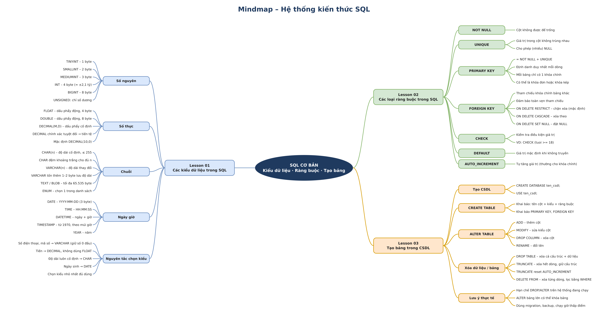

# Hệ thống kiến thức Mindmap: SQL – Kiểu dữ liệu, Ràng buộc và Tạo bảng

Mindmap tổng hợp kiến thức của 3 bài học trong Session, đi từ tổng quan đến chi tiết:

1. **Bài 1:** Các kiểu dữ liệu trong SQL
2. **Bài 2:** Các loại ràng buộc trong SQL
3. **Bài 3:** Tạo bảng trong CSDL

[Xem mindmap tương tác trên draw.io](https://app.diagrams.net/?title=mindmap-sql.drawio#R7V1bc%2BK4Ev41PM6WJVm29WgbMkkNkF2S7G6ethxwwDVgp4iZmZxffyTfsC2ZZM9JeqaE9mEWCwhg9dfqr68jEu5%2BfN5HT5tZtoq3I2ytfozIeIQxsi2L%2F0%2BsvJQrrF5Y75NVudRauEn%2BE1fvrFcPySp%2BrtbKpTzLtnny1F1cZmkaL%2FPOWrTfZ9%2B7L3vMtqvOwlO0jjtfQyzcLKNtLL3sr2SVb6pVx2q9%2FDJO1pv6o3H9zC6qX10tPG%2BiVfa9tUQmIxLusywvH%2B1%2BhPFW3L3ujbkYeLb5Zvs4zd%2FyhpSU7%2FgWbQ%2FVr7v5Y8oXwlHojHz%2BZisYTdAo8Ec%2Bno%2BwM8LkRzQiwZekWA5GHjmIrayu%2FAt%2BsW2ec8VzoxCPApc%2FWIxCwv9muuaPHw7Vaxhbtl9zW38aysSr6isi3lTcsPyl3gb%2BS%2FiO84vg%2BybJ45unaCme%2Bc6Fjq9t8t2WXyH%2B8DHZbsNsm%2B2L9xH0SCL6KNazNG%2BtPxb%2F8fXnfJ99jYfeUckjcurr6huJT6puZrzP4x%2BDO4KafeYIibNdnO9f%2BEuqN3xCzPqtko4KHzZj9cr3o7wRr1rbtEWtlrSokvF18wFHKeAPKkEYEApbEopp%2FPycpXzNQi0hCIsNRWIDv75dHvjdLUSgELTenu6zQ7qKV9Xt%2FHf7uopi73Gp2j9n6cUP%2Ff2zFftXvrMGNX6nHaV2f0cpUu0odhU76rzHhlIZPCuu0qpL%2FjuS%2FGURb6M8ydLJ8Zlgedh%2Fa3YjTle%2B0J78Ms3SuLsX8p0b3oXyy4hvcPqO8i%2BcHfbLuKuq8mi%2FjvO2pMp3fl%2F8lm%2Fdv%2F9%2F3UFH1pO1AuN%2Fnuu0w0sBBj%2F9mTJNPkgnuV5fghEjCglGKp1E7He4%2F64OEmwrJNiBkmBPkuDbq%2Fn91fxWHL8TPOJbxzjEhIK3Hl7yWLrhXH7y7i2Ltsk65Y%2F35WYHQsgSbif51fouWa22Qwd0W27lu13tTxsO1dIz%2FzNJup7Gj%2BIW2seVRSVy9nsdxEjS2wirpJ5ghdTj95B6poPUOwqp96CkvuYMbcU986dTWe6xkfthuaewco%2BQroKPLDDJx5Lkzybjq7uZLPrEiP6w6HvAok%2B0FX0MJvoygZWF3m6Enm%2BlVzzDRp5XOyPEtw2FLZRXdr5wTzCDEBkhGAEjhGqLEDA6i2Q%2BG1x9lkHimZNhWO5tYLl3tZV7MBKMZBZ8N7%2B5%2BjyfjEfEFzGDTe2rZOKbt308K%2BESD6zCMY4U%2FmgDCe7BBIaEtgQZgTFkbJ12beY1IgLh6D8H3yZxLVDfJka6OjcxGNvFMtu9mF77fXtmVQcUqYhEPW3qS%2FZS2P22EPk6LilUfNghCkbhS1BBFFThYy3YcX17ulgBo8dYpsfj67tgOnkHsBjCcAIsNjBYqL5gAWPKWGbK40l4xWMI3Gs040I%2FLtxCbwfOsm1cdVDkBenG4EaBGxcYN66%2BuAFj2tgbxo1g2SJZYizkne98k0WU8yyKOlUolw4ZlNQ4c0as%2BGlNYhFKW55azzUoklFkW8AoYvqiCIycE5mcz6rTJHCX6gPEOp5PItoYWiZuoQYEgQUEQdoCgoDxfCLz%2FHDT5BK7yXl4qKjtgnqoCNHVQ0XAWDeRWXd46S%2B4lk5lBtFj12X0QSTPJ29gEGH9x9jIF84rTKnR%2Fwr977qw%2Bl%2BPLGysQhEYHSfOAIp6QHB3oihhk3UKSHjpQX19UVwvN1n%2Fnb6oQkkNXmS8UAsYL66%2BeAGj4USm4X%2F6i%2F%2Fx4Mk3kez6pYkBiwIsBBgsTF%2BwgLFt2xoGS%2BNdYqWvqfRg%2BbuiYqIG0DGH3NqW2SKHVzBlkCMhx4FFjo20RY4NRsttmZbfTv4uou9YlIAG0%2Bugd9LkXbdugZGIP3Lob1SYyiaMOAQQBgwQoi9AwNi%2FLbP%2Fyfxu1sPEMftwnFaleHW19CoqfLvPVbDEBAoVyHAwMDL0ZfQ2GKO3ZUY%2FX5f2kfjAdR3jY%2BPz8O262Ab17drallbbYCzbVgS7%2Fdt%2BPtU9%2F%2B%2FTbPZpPC5rjo5ldyY%2Bp9LmDoPV5lpQaFuVTW6DUWhqKdoMzPpIuLzk1RazGf%2Fn5saIvkL0GazoU6St6FMwDkyx8hBQiH%2Fasm9GOHjFyjF44DYRMB6IvngAo7zUVh4FN7f%2B7PcBX5AvsICY6IMVFk7WWMTndgItgZ8YnLyKEwqME6ovTsAIMJUJ8P2kDGm3zwzhIfXIzoi9Quw9YLF39RV7MM5MPYXfp9VFrzoURK7GUnaNdvtNnoNfyPMcUL8QZbr6hSgYG3Zeqa0uo17H9qhlZLlJWhKRsbA2gHzSb0jQLoU4xqm5Y6mxkor2q533WN14NP8Q0ZPV%2BJ8Up4pHEOip4mhBwmu13m1yCUbCHUUgulsl1EZNUykRFtmCBc%2Bwy3Bb8bgoa7WqQnKDEAkhDjBCiL4IAaPljkzLiwPBGkj62x4qWLwh87wDrvI8MqiRUMOAUUP1RQ1c%2F%2B%2FTUernRBL%2FMgBoxL8v%2FgwDi7%2Brr%2FiDkXXHU5TdnSDkVto8e3G8Eh0RcmXBRcvcMoiREEOBEcP0RQwY9XetE0NUsHqIyrbD%2FK398LycD5uhQmNvZau2w8MPxHF%2B1gwV7L6t%2B%2BbHjVBxfwl23uzCO85QccHIuSuT8%2Fm1SBKf301%2Fqhx%2FkBeXTwTrSe0nCjs1heggtK6q5YALRphdReF2o4zzvuOosm3KVrGVhUPkTh3kWI1alBT9G8NnWxghetk9Hu5DxQK1eVyqBVJUqdwuGEl2HUV35as%2F7iZnodsphtXtrr66HYzXujKv%2FZyUBnlbQXtBy%2BZeDiv%2FfN8KG6Sb6GC0er%2FpBoZV60wLkKgyNVwwKutZCudPVna2FFBhT2XYOd0cI21lUFlt2J87BlxYDHhIWwx4YNTVk6nr7wseO17c88Uvk%2FuzsHAQhS1N8%2FSlrx4YffUU8V7xr9V2vVRlCAPW%2BrkrbO6Th9XYWpBRT0VGPTAy6jmn8xyqjIWqrn51eJHjVLt2X8kqRoWNq0bGhw2MD1dffMDNg%2FYGWgvX8v7Q7Z3XnYy1LMBQz4uuSDCJer29DU66OHGBccL0xQkY%2B2UK9tsIfzMcq3Dob8uAbQ8Qx4iAXySgNvndZQfv9ku%2FNnzaIKcb7bVgkcOQtshhYJyZKWZyXS8mfNriGXFmYiFQzsz05cwMjDMzRenyJtoV1k1Sa%2B%2BLwwnLp289la%2FzFSMUz1612w6sateCXDOlagcj1%2BwkuRZSv%2BtgQEQL8qzKZxPvq0HEypI3FbYMTnqzdYFx4uqLEzCSzWSSfT0vCs%2Bmk6I%2F2IL3w1hchbfqRpCCI6T1iKyKTWBv99oEIGbAI1lhwOBh%2BoIHjHkjy3oFPaF%2FE%2FrjfnulFlrKDjIGDF0wEFgwIAtpi4ZKRmHggF%2BBw82kHdFTT3UQx0ZuMjMGkOFAI4NojAwMhwzVbK1J%2BOUsPEw28kA9TMii2rqYKkmCEVqZQ385FlHuinTSSG4Sgw6dasuCH6wHclaNeu%2BNwPWA1bsWHLpRrz2oOHBQUUyxGvPuwUWXiULPC16cH7JilAh21kKYyywn5Bk%2BrEACgUYC0xkJcJQYWYqx6hf%2B3fT2PGwdF7aAEiGkr62D4Kgrwm%2Bvs3nVvcmDaYlcecMT%2BFptvoy%2B7%2BLGgy2nREgLYtuo2x5w4Jgtkpmtf3d7%2Fc%2FVPFxMZpP5eah9ilxgta8xxUVwFBfJFPe20tJBofjLptaFBh%2FisIVlv%2BkU1LNxa3rzUAaGMfrlAmUMfAjoQX%2BR0uhHcPQXeSd6CZFWL6Hbpn9QJqcg1fXL4c34fZutPD7GzlLZMnvlsgceIPllmgZ5SgR8XNMghH4J2ttswzt2DaqEEkT%2BsTVwjNSS%2FrNFGswQchBsE3iEkQ4C3GjQrghjOAKMZQLMDfhyRiDvFOoH%2Fo14mMfpP8vn1bb5qcZ8Oco%2BcA4PwkQL2cdKFoDhOCyWOeydkfbXpB06SQdTnaUdjvNiZ1jTcz0%2FnZyHoeIBJyVgV2dDBY5rYplrftlEZT1w4Z%2FJyrhrfhzU1G2IVXaS6LWDLheHG9oa5d9FjwscnsVMD%2BXvKNEDx1SJ9Sp6sNVrHCRmz5yuizz7hlnQeTsEaQwHAsd6icx6%2FentZHFWppDLLFhTiBCNTSECx1uJIvY6HvdHF5chJ3%2FXN4SMDu%2BNJgbOQCB68FmizK0ncHyWyHx2dj2%2BurjvAaEeM%2BmPI9n%2BN8g4gQzo3Bzi6owMOKpMZKo8XlyL2fbh9fRuNh8uSzRwGIaDh6DhwHSGAxz3tWXuu5jM%2FdlkuBiRI4AmHWeSAUMXDDYwGGykMRhsOOZry8z376P%2BX7Xnc2%2BPtVylq%2FRCyt05A5bMMOz4DGTrzJJtOJZs20NWUOXiOW0E%2BeVg%2B%2BaCHo5zNPxlEzo4gRhzZHSPDA84y9PWg2jb6iMDjmjbimTpxd08LEPHAyBq%2BgRd5N0W1WGZUt1CzSDEDIC6JxGCBpCrM4Dg%2BLjtnQLQPn6OBUZeKZ85e%2Bm3oaWf6Sz9cPSbqiqDq8ZAF4vr2YkmWfUpERSZGb1DZNuM%2BV62eElQjKy0%2FrqcLMy8EAlDwBOeEEUaY4jCsXYqs%2FZpWXlWMHOBi3G763tQjO3OGxvsLJg6b1rFYKk61ZmqUziqTmWqftnU0aSdtqOCMJQ0%2FqLO2CgZQ5ny14w9cNtwKOcYVw7eqD01RHzAizknJCQBD5ZCVA%2BuTtUHBRxXp85gYlOv6rI2n1iQdsbmdCeHtIuYT7p%2BDWRsaMi4OkMGjp1TRbS8NS15l6z3xS0sWcdDtPx6eCofd8%2BQo1eLtWwx4dZ6kpvliTZ6BkE9BLnQCGI6I%2BiDGD6%2F3GdZ3nruM5e4zSxbxeIV%2FwU%3D)

## Nội dung chi tiết

### Bài 1 · Các kiểu dữ liệu trong SQL

- Số nguyên
  * TINYINT – 1 byte
  * SMALLINT – 2 byte
  * MEDIUMINT – 3 byte
  * INT – 4 byte (≈ ±2,1 tỷ)
  * BIGINT – 8 byte
  * UNSIGNED: chỉ lưu số dương
- Số thực
  * FLOAT – dấu phẩy động, 4 byte
  * DOUBLE – dấu phẩy động, 8 byte
  * DECIMAL(M,D) – dấu phẩy cố định, chính xác tuyệt đối → dùng cho tiền tệ
  * Mặc định DECIMAL(10,0)
- Chuỗi
  * CHAR(n) – độ dài cố định (≤ 255), đệm khoảng trắng cho đủ n
  * VARCHAR(n) – độ dài thay đổi, tốn thêm 1–2 byte lưu độ dài
  * TEXT / BLOB – tối đa 65.535 byte
  * ENUM – chọn 1 giá trị trong danh sách
- Ngày giờ
  * DATE – YYYY-MM-DD (3 byte)
  * TIME – HH:MM:SS
  * DATETIME – ngày + giờ
  * TIMESTAMP – từ năm 1970, theo múi giờ
  * YEAR – năm
- Nguyên tắc chọn kiểu
  * Số điện thoại, mã số → VARCHAR (giữ số 0 ở đầu)
  * Tiền → DECIMAL, không dùng FLOAT
  * Độ dài luôn cố định → CHAR
  * Ngày sinh → DATE
  * Chọn kiểu nhỏ nhất đủ dùng

### Bài 2 · Các loại ràng buộc trong SQL

- NOT NULL
  * Cột không được để trống
- UNIQUE
  * Giá trị trong cột không trùng nhau
  * Cho phép (nhiều) giá trị NULL
- PRIMARY KEY
  * = NOT NULL + UNIQUE
  * Định danh duy nhất mỗi dòng
  * Mỗi bảng chỉ có 1 khóa chính (khóa đơn hoặc khóa kép)
- FOREIGN KEY
  * Tham chiếu khóa chính của bảng khác
  * Đảm bảo toàn vẹn tham chiếu
  * ON DELETE RESTRICT – chặn xóa (mặc định)
  * ON DELETE CASCADE – xóa theo
  * ON DELETE SET NULL – đặt giá trị NULL
- CHECK
  * Kiểm tra điều kiện giá trị, ví dụ CHECK (tuoi >= 18)
- DEFAULT
  * Gán giá trị mặc định khi không truyền dữ liệu
- AUTO_INCREMENT
  * Tự tăng giá trị (thường dùng cho khóa chính)

### Bài 3 · Tạo bảng trong CSDL

- Tạo CSDL
  * CREATE DATABASE ten_csdl;
  * USE ten_csdl;
- CREATE TABLE
  * Khai báo tên cột + kiểu dữ liệu + ràng buộc
  * Khai báo PRIMARY KEY, FOREIGN KEY
- ALTER TABLE
  * ADD – thêm cột
  * MODIFY – sửa kiểu cột
  * DROP COLUMN – xóa cột
  * RENAME – đổi tên
- Xóa dữ liệu / bảng
  * DROP TABLE – xóa cả cấu trúc lẫn dữ liệu
  * TRUNCATE – xóa hết dòng, giữ cấu trúc, reset AUTO_INCREMENT
  * DELETE FROM – xóa từng dòng, lọc được bằng WHERE
- Lưu ý thực tế
  * Hạn chế DROP/ALTER trên hệ thống đang chạy
  * ALTER trên bảng lớn có thể khóa bảng
  * Dùng migration, sao lưu và chạy vào giờ thấp điểm
