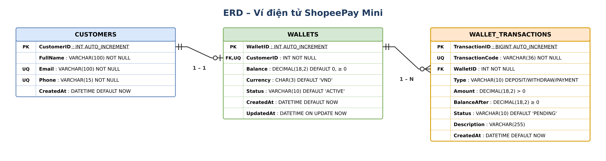

# Module "Ví Điện Tử ShopeePay Mini"

Thiết kế "khung xương" cơ sở dữ liệu (DDL) cho module ví điện tử: người dùng nạp tiền, rút tiền và thanh toán nhanh. Thiết kế dùng ràng buộc đa lớp để chặn dữ liệu sai ngay tại tầng CSDL.

## 1. Sơ đồ ERD

[](erd-shopeepay-mini.png)

[Xem sơ đồ ERD trên draw.io](https://app.diagrams.net/?title=erd-shopeepay-mini.drawio#R7Z1tc6I6GIZ%2FjV%2FPCAjSjxRx6xxfenzZzn7qpBKV2UicELd1f%2F1JBEQhvrS1wm4y0zokQgh57scLyQ3WDHf59o2A1aKHfYhqen1OAr9mtGq6Xmf%2FrGIF5nCvwvBqhkswpvHS8s2FiG93uFX7yLta2iaBIb1kA%2FrsTkbjQc8bjuJNfwG0TvqTeyeiG5S8Ey3Aii9S8MKr7iMKCB0Fv3md0WAVUxxSEISQsAptW0YIrKJgu3qrzmsWAfK7YIPXNG0oLd3PgjfoD%2FFrlGxN8GuXNZYWZ6zxUdIZXgYomIdsecqOme%2BRbY%2BQixEm294aPoD2bLrtJsE%2F4d471tSGL7O0ybj%2FGu9%2FMhaQUPh2dGS1XbxYjCFeQko2bJVkg0YS301cbCbF18Cni3SNpG4Bg%2FkibbTZiCtBFFfMdy1nYWQLSSTPRvWZ1AuBPR1PNvBsBBaYBL95FFESsP0Yb8uvwRKBED5A4Oeq7rG%2FSar2QxHiEAq14BO8GgMyhzSpWOEgpNvjN%2B%2FZHzsCt%2F6PWTNZX11W1rIy%2B%2BOrE%2BrikIWXaY63AUFEX2FECzEPwgUkAa%2BneJXsDMFZul%2BSxIEvv2BK8TKR2EV6yOVSURmJFIzGZVLQ7Wsr4flnQQuP%2Fx5VAzs2GgA0hFMKwvk20TEbghniAmktAt%2BHYZzrIV8li6cg6O8Kw27o8zHJZ%2F5%2B2n4kTElyFCO1FxrznZFJGstG7d2tAcQ%2BxkJAWR6tQz8qhHvXz48o4FfxY34dsdGGpMMKbJAd9trpj9mrMxkPnjt9d%2Bj1PF5xA5mkH%2BWxGK6kmmgFpkE478arWjkdmdfUzdthlPcCb1xXR0bJQtIUVKoFFUsvCSqaACpSI0WTCymaACntNUJ9sIQ7oHx3hu6DM6zptsZFeceq%2BgPOmP6k2%2F2byHI1uUhDEl2RpFokuauXRBJdQJLJf1KzRJeLJbqAJd4SBEiB5MNakQYkhgJJtUCiaXZJJDEUSYTZIQ9JDAFJHhc8RAKSmAokF0hFGpA0FEgqBpKGVRJIGuriliA35MFIQzRfQiDbl%2B%2FQHUpaztgbd3oeX%2FTazqS75cjgSW6MNGTEyJPT7XrjopfioP7PdVKY0PYbIieFrb8YlvU1TgrT%2BpiVQjfq18BBEjplpLjhecFeulTERpGpQJkoBGnxl58S7EW%2FeELwBBCCVNknPqsYKc4MlHWiYhi5rXEiU4EAI22GEVfG65SHuSELS7T3mPGkvjh5Th%2BSkENZJSpFjtsaJTIVqGuShaSQBRkigwT7rAbhNJvYanlup%2Bd0%2BcQW65arx5Nb2YVJnoN8ZU%2Bv2Xc1x4yr5GWKLjVTlGuiUky5sWcik4GCSiErZIGKIfweQtjATDc7qiReCSNPk5rO5maNN73JRvl7v7VflBkqhtRQUQ6KakHltv6JTAYKKoWskAUqIufEiAK6joRe7lNYcdxx57unyHJSRZKQxVRkqRRZmuVMwpuKLIWskIUspvLkfRAdptTosBQ6qoQOvV7OxLul0FHIClnQYQnQMVn5x9Ex6LOXySOvUfiw5MXH83jo9Ef8i%2Bigf8zcLVjnjzV6z2bQmgofmec3717q9a8xemt1%2B4NOb9u6HiMO4qhc3zc%2FbSjkUaUc4Hl1KDf4mdSR4tyioIriecaYgDACUxrgcM%2Fcd9%2F5ptzin1aUdKcgykVeYSyV4SjPq0M9AONM6siIJe00llz2iHLB5JxhqcdjvEtIEtJIOdMrS6MyXOp5dRy510nRSCr%2FekEVF99Kq9BzoWokRI8ysFcWPaWY2fPyUNN9JzNHRvKIDO%2FjzQqedCY%2BDkYdRqH2U2f80Bo6bCaw%2Fej8%2BNsu1n2BniRkkvK%2FV5dJZXjh8%2FJQTDqZOTIySeSXd5Zsh%2FTMjb3MFz%2Bn21GX%2BDbey1QkIYmUX766JGqWb19QPvrTmSMjiczjz5hwZtwtdoZH6rkSF4tJQiApF35lgVSKIz8vDwWkk5kjI5Cs691K%2FOj1W53%2BN3Uv8cXykhBRTYWoyiLKKN%2FN0FSIOpk5MiKqKUBUC0ZTEqy4s07AKd2Mf3VKweeEcCSEj63gU1n4mOXbGWwFn5OZIyN8bPVAjCsgyJYPQQSi4t2tWnoNt167Y46OulYQCPTnME1iNqoB3QwhAvw8x8veOUhtnSOKLlGS9Vs4OYRsheQNlyD0B1uZwNDPqn9Dgsd4EO7ulm4HKMUbW3GvFMvpKRlLfScE3tHTtyKz48JrMoWCny9LRoampLvoQfRkOxC%2FDvf6GQywBrWzIeqXG6IeCDc3jFH%2B97hEEbrMLfvZaLEiwZju5x8Bq0WP3UfD1%2Fgf)

## 2. Phân tích nghiệp vụ

| Quy tắc nghiệp vụ | Thiết kế |
|---|---|
| Lưu số tiền hiện có của mỗi khách hàng | Bảng `WALLETS`, cột `Balance DECIMAL(18,2)` |
| Mỗi khách hàng tối đa **một** ví | `WALLETS.CustomerID` vừa là `FOREIGN KEY` vừa `UNIQUE`, tạo quan hệ 1 – 1 |
| Số dư không bao giờ âm | `CHECK (Balance >= 0)` |
| Mọi biến động số dư đều được ghi lại | Bảng `WALLET_TRANSACTIONS`, quan hệ 1 ví – N giao dịch |
| Lưu định danh, ví, loại, số tiền, thời điểm, trạng thái | `TransactionID` / `TransactionCode`, `WalletID`, `Type`, `Amount`, `CreatedAt`, `Status` |

Ngoài ra, thiết kế bổ sung thêm để phục vụ đối soát:

- `TransactionCode`: mã giao dịch do ứng dụng sinh ra, có `UNIQUE` để chống ghi trùng khi người dùng bấm hai lần hoặc mạng gửi lại yêu cầu.
- `BalanceAfter`: số dư ngay sau giao dịch, giúp kế toán dò lại lịch sử mà không cần cộng dồn toàn bộ bảng.
- `Status` của ví (`ACTIVE` / `LOCKED` / `CLOSED`): cho phép khóa ví khi nghi ngờ gian lận.

**Vì sao dùng `DECIMAL(18,2)` cho tiền?** Đây là kiểu dấu phẩy cố định, lưu chính xác tuyệt đối từng đồng. `FLOAT`/`DOUBLE` là số chấm động, sẽ gây lệch tiền khi cộng dồn nhiều giao dịch.

## 3. Kịch bản rủi ro và ràng buộc chặn

| # | Kịch bản nhập liệu sai | Vô tình / cố ý | Hậu quả nếu không chặn | Ràng buộc chặn |
|---|---|---|---|---|
| R1 | Thanh toán số tiền lớn hơn số dư hiện có | Cả hai | Ví bị âm tiền, công ty mất tiền | `CHECK (Balance >= 0)` |
| R2 | Nhập số tiền âm hoặc bằng 0, ví dụ "rút -200.000đ" để được cộng tiền | Cố ý | Gian lận, tự tạo tiền | `CHECK (Amount > 0 AND Amount <= 100000000)` |
| R3 | Tạo ví thứ hai cho cùng một khách hàng | Cả hai | Vi phạm quy định "một khách hàng một ví", số dư bị phân tán | `UNIQUE (CustomerID)` trong `WALLETS` |
| R4 | Bấm "Thanh toán" hai lần, hoặc mạng gửi lại cùng một yêu cầu | Vô tình | Bị trừ tiền hai lần | `UNIQUE (TransactionCode)` |
| R5 | Ghi giao dịch cho một ví không tồn tại | Cả hai | Giao dịch "ma", không đối soát được | `FOREIGN KEY (WalletID)` |
| R6 | Tạo ví cho khách hàng không tồn tại | Cả hai | Ví "mồ côi" không có chủ | `FOREIGN KEY (CustomerID)` |
| R7 | Loại giao dịch hoặc trạng thái tùy ý, ví dụ `'HACK'`, `'nap tien'` | Cả hai | Báo cáo sai, không phân loại được | `CHECK (Type IN (...))`, `CHECK (Status IN (...))` |
| R8 | Bỏ trống số tiền, ví hoặc loại giao dịch | Vô tình | Bản ghi thiếu thông tin, không đối soát được | `NOT NULL` |
| R9 | Không nhập số dư, thời điểm hoặc trạng thái khi tạo mới | Vô tình | Số dư NULL, thiếu mốc thời gian | `DEFAULT 0`, `DEFAULT CURRENT_TIMESTAMP`, `DEFAULT 'PENDING'` |
| R10 | Xóa ví hoặc khách hàng đang có lịch sử giao dịch | Cả hai | Mất dấu vết đối soát | `FOREIGN KEY ... ON DELETE RESTRICT` |
| R11 | Đánh dấu giao dịch `SUCCESS` nhưng không ghi số dư sau giao dịch | Vô tình | Không đối soát được giao dịch đã hoàn tất | `CHECK (Status <> 'SUCCESS' OR BalanceAfter IS NOT NULL)` |

## 4. Đủ 6 "Anh bảo vệ"

| Ràng buộc | Vị trí trong script | Nhiệm vụ |
|---|---|---|
| `PRIMARY KEY` | `CustomerID`, `WalletID`, `TransactionID` | Định danh duy nhất mỗi khách hàng, ví và giao dịch |
| `FOREIGN KEY` | `WALLETS.CustomerID`, `WALLET_TRANSACTIONS.WalletID` | Ví phải thuộc khách hàng có thật, giao dịch phải thuộc ví có thật (R5, R6, R10) |
| `NOT NULL` | Mọi cột bắt buộc: `Balance`, `Amount`, `Type`, `WalletID`… | Không cho bỏ trống thông tin quan trọng (R8) |
| `UNIQUE` | `WALLETS.CustomerID`, `TransactionCode`, `Email`, `Phone` | Một khách hàng một ví, chống giao dịch trùng (R3, R4) |
| `CHECK` | `Balance >= 0`, `Amount > 0`, `Type IN`, `Status IN`… | Chặn số dư âm, số tiền âm và giá trị không hợp lệ (R1, R2, R7, R11) |
| `DEFAULT` | `Balance = 0`, `Status = 'ACTIVE'/'PENDING'`, `CreatedAt = NOW` | Tự điền giá trị hợp lệ khi không nhập (R9) |

## 5. Database Schema Script

```sql
-- =====================================================
-- Module "Ví Điện Tử ShopeePay Mini" - Database Schema Script
-- MySQL 8.0.16+ (CHECK constraint được thực thi từ 8.0.16)
-- Đủ 6 "Anh bảo vệ": PRIMARY KEY, FOREIGN KEY, NOT NULL, UNIQUE, CHECK, DEFAULT
-- =====================================================

CREATE DATABASE IF NOT EXISTS shopeepay_mini;
USE shopeepay_mini;

-- Xóa theo thứ tự ngược: bảng con trước, bảng cha sau
DROP TABLE IF EXISTS WALLET_TRANSACTIONS;
DROP TABLE IF EXISTS WALLETS;
DROP TABLE IF EXISTS CUSTOMERS;

-- -----------------------------------------------------
-- 1. CUSTOMERS - khách hàng (bảng cha)
-- -----------------------------------------------------
CREATE TABLE CUSTOMERS (
    CustomerID INT AUTO_INCREMENT,
    FullName   VARCHAR(100) NOT NULL,
    Email      VARCHAR(100) NOT NULL,
    Phone      VARCHAR(15)  NOT NULL,
    CreatedAt  DATETIME     NOT NULL DEFAULT CURRENT_TIMESTAMP,

    CONSTRAINT pk_customers       PRIMARY KEY (CustomerID),
    CONSTRAINT uq_customers_email UNIQUE (Email),
    CONSTRAINT uq_customers_phone UNIQUE (Phone),
    CONSTRAINT chk_customers_email CHECK (Email LIKE '%_@_%._%'),
    CONSTRAINT chk_customers_phone CHECK (Phone REGEXP '^[+]?[0-9]{9,14}$')
);

-- -----------------------------------------------------
-- 2. WALLETS - ví điện tử (mỗi khách hàng tối đa 1 ví)
-- -----------------------------------------------------
CREATE TABLE WALLETS (
    WalletID   INT AUTO_INCREMENT,
    CustomerID INT            NOT NULL,
    Balance    DECIMAL(18, 2) NOT NULL DEFAULT 0,
    Currency   CHAR(3)        NOT NULL DEFAULT 'VND',
    Status     VARCHAR(10)    NOT NULL DEFAULT 'ACTIVE',
    CreatedAt  DATETIME       NOT NULL DEFAULT CURRENT_TIMESTAMP,
    UpdatedAt  DATETIME       NOT NULL DEFAULT CURRENT_TIMESTAMP ON UPDATE CURRENT_TIMESTAMP,

    CONSTRAINT pk_wallets          PRIMARY KEY (WalletID),
    CONSTRAINT uq_wallets_customer UNIQUE (CustomerID),              -- 1 khách hàng = tối đa 1 ví
    CONSTRAINT chk_wallets_balance CHECK (Balance >= 0),             -- không bao giờ âm tiền
    CONSTRAINT chk_wallets_currency CHECK (Currency = 'VND'),
    CONSTRAINT chk_wallets_status  CHECK (Status IN ('ACTIVE', 'LOCKED', 'CLOSED')),
    CONSTRAINT fk_wallets_customers
        FOREIGN KEY (CustomerID) REFERENCES CUSTOMERS (CustomerID)
        ON DELETE RESTRICT
        ON UPDATE CASCADE
);

-- -----------------------------------------------------
-- 3. WALLET_TRANSACTIONS - lịch sử biến động số dư
-- -----------------------------------------------------
CREATE TABLE WALLET_TRANSACTIONS (
    TransactionID   BIGINT AUTO_INCREMENT,
    TransactionCode VARCHAR(36)    NOT NULL,                         -- mã giao dịch do ứng dụng sinh (chống trùng lặp)
    WalletID        INT            NOT NULL,
    Type            VARCHAR(10)    NOT NULL,                         -- DEPOSIT / WITHDRAW / PAYMENT
    Amount          DECIMAL(18, 2) NOT NULL,
    BalanceAfter    DECIMAL(18, 2) NULL,                             -- số dư sau giao dịch (để đối soát)
    Status          VARCHAR(10)    NOT NULL DEFAULT 'PENDING',       -- PENDING / SUCCESS / FAILED
    Description     VARCHAR(255)   NULL,
    CreatedAt       DATETIME       NOT NULL DEFAULT CURRENT_TIMESTAMP,

    CONSTRAINT pk_wallet_transactions PRIMARY KEY (TransactionID),
    CONSTRAINT uq_transactions_code   UNIQUE (TransactionCode),
    CONSTRAINT chk_transactions_type   CHECK (Type IN ('DEPOSIT', 'WITHDRAW', 'PAYMENT')),
    CONSTRAINT chk_transactions_amount CHECK (Amount > 0 AND Amount <= 100000000),
    CONSTRAINT chk_transactions_status CHECK (Status IN ('PENDING', 'SUCCESS', 'FAILED')),
    CONSTRAINT chk_transactions_balance_after
        CHECK (BalanceAfter IS NULL OR BalanceAfter >= 0),
    CONSTRAINT chk_transactions_success_has_balance
        CHECK (Status <> 'SUCCESS' OR BalanceAfter IS NOT NULL),
    CONSTRAINT fk_transactions_wallets
        FOREIGN KEY (WalletID) REFERENCES WALLETS (WalletID)
        ON DELETE RESTRICT
        ON UPDATE CASCADE
);

-- =====================================================
-- DỮ LIỆU MẪU
-- =====================================================
INSERT INTO CUSTOMERS (FullName, Email, Phone) VALUES
    ('Nguyễn Văn An', 'an.nguyen@gmail.com', '0912345678'),
    ('Trần Thị Bình', 'binh.tran@gmail.com', '0987654321');

INSERT INTO WALLETS (CustomerID) VALUES (1), (2);   -- Balance tự = 0, Status tự = 'ACTIVE'

-- Nạp 500.000đ vào ví 1 (giao dịch nguyên tử: cập nhật số dư + ghi lịch sử)
START TRANSACTION;
UPDATE WALLETS SET Balance = Balance + 500000 WHERE WalletID = 1 AND Status = 'ACTIVE';
INSERT INTO WALLET_TRANSACTIONS (TransactionCode, WalletID, Type, Amount, BalanceAfter, Status, Description)
VALUES ('TXN-20261116-0001', 1, 'DEPOSIT', 500000, 500000, 'SUCCESS', 'Nạp tiền từ ngân hàng');
COMMIT;

-- Thanh toán 120.000đ từ ví 1
START TRANSACTION;
UPDATE WALLETS SET Balance = Balance - 120000 WHERE WalletID = 1 AND Status = 'ACTIVE';
INSERT INTO WALLET_TRANSACTIONS (TransactionCode, WalletID, Type, Amount, BalanceAfter, Status, Description)
VALUES ('TXN-20261116-0002', 1, 'PAYMENT', 120000, 380000, 'SUCCESS', 'Thanh toán đơn hàng #1001');
COMMIT;

SELECT * FROM WALLETS;
SELECT * FROM WALLET_TRANSACTIONS;

-- =====================================================
-- KIỂM THỬ KỊCH BẢN RỦI RO: mỗi lệnh dưới đây PHẢI bị từ chối
-- =====================================================
-- R1. Thanh toán vượt số dư (ví 2 đang có 0đ)      -> CHECK chk_wallets_balance
-- UPDATE WALLETS SET Balance = Balance - 50000 WHERE WalletID = 2;

-- R2. Nhập số tiền âm hoặc bằng 0                   -> CHECK chk_transactions_amount
-- INSERT INTO WALLET_TRANSACTIONS (TransactionCode, WalletID, Type, Amount) VALUES ('TXN-R2', 1, 'WITHDRAW', -200000);

-- R3. Tạo ví thứ hai cho cùng một khách hàng        -> UNIQUE uq_wallets_customer
-- INSERT INTO WALLETS (CustomerID) VALUES (1);

-- R4. Gửi lại cùng một giao dịch (bấm "Thanh toán" 2 lần) -> UNIQUE uq_transactions_code
-- INSERT INTO WALLET_TRANSACTIONS (TransactionCode, WalletID, Type, Amount) VALUES ('TXN-20261116-0002', 1, 'PAYMENT', 120000);

-- R5. Giao dịch cho ví không tồn tại                -> FOREIGN KEY fk_transactions_wallets
-- INSERT INTO WALLET_TRANSACTIONS (TransactionCode, WalletID, Type, Amount) VALUES ('TXN-R5', 999, 'DEPOSIT', 100000);

-- R6. Tạo ví cho khách hàng không tồn tại           -> FOREIGN KEY fk_wallets_customers
-- INSERT INTO WALLETS (CustomerID) VALUES (999);

-- R7. Loại giao dịch hoặc trạng thái không hợp lệ   -> CHECK chk_transactions_type / chk_transactions_status
-- INSERT INTO WALLET_TRANSACTIONS (TransactionCode, WalletID, Type, Amount) VALUES ('TXN-R7', 1, 'HACK', 100000);

-- R8. Thiếu thông tin bắt buộc (không có số tiền)   -> NOT NULL
-- INSERT INTO WALLET_TRANSACTIONS (TransactionCode, WalletID, Type) VALUES ('TXN-R8', 1, 'DEPOSIT');

-- R9. Xóa ví / khách hàng đang có lịch sử giao dịch -> FOREIGN KEY ON DELETE RESTRICT
-- DELETE FROM WALLETS WHERE WalletID = 1;
```

## 6. Lưu ý vận hành

- **Thứ tự tạo bảng:** `CUSTOMERS` trước, rồi `WALLETS`, cuối cùng `WALLET_TRANSACTIONS`. Khi xóa thì làm theo thứ tự ngược lại.
- **Cập nhật số dư và ghi lịch sử phải nằm trong một transaction** (`START TRANSACTION ... COMMIT`). Nếu số dư bị âm, `CHECK` làm câu `UPDATE` thất bại và toàn bộ giao dịch được `ROLLBACK`. Nhờ vậy không có lịch sử nào ghi nhận một khoản thanh toán không thành công.
- **Ràng buộc chặn dữ liệu sai, nhưng không thay thế logic nghiệp vụ.** Việc đảm bảo `Balance` khớp với tổng các giao dịch vẫn do tầng ứng dụng (hoặc stored procedure) đảm nhiệm, trong đó transaction và `BalanceAfter` là công cụ đối soát.
- `CHECK` chỉ được MySQL thực thi từ phiên bản **8.0.16** trở lên.
